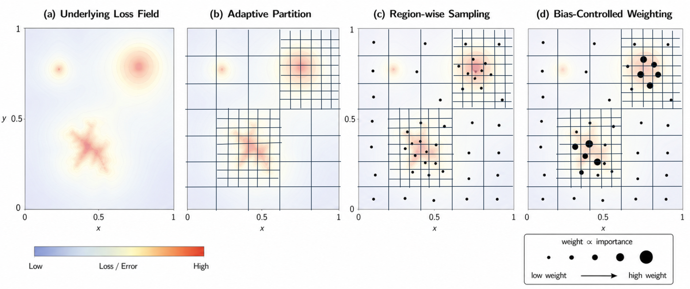

# ACES: Adaptive Coverage-aware Efficient Sampling

Official code for [**"Efficient Neural Field Learning via Adaptive Coverage and
Focused Sampling"**](https://arxiv.org/abs/2610.02410) (NeurIPS 2026).

ACES is a region-level adaptive sampling framework for training implicit
neural representations (INRs) on heterogeneous continuous fields. It combines
adaptive spatial partitioning (a quadtree/octree refined by per-region
residual variance) with residual-aware, bias-controlled importance weighting,
to balance domain coverage against focused refinement of high-error regions.



## Installation

```bash
conda env create -f environment.yml
conda activate <env-name>   # see the `name:` field in environment.yml
git submodule update --init --recursive   # pulls in coral (github.com/LouisSerrano/coral)
```

Python 3.11 is required — [Hydra](https://hydra.cc) (used for configuration)
is incompatible with Python 3.12+.

## Data

Scripts expect a `DATA_ROOT` directory containing:
- `NS2d/ns_data_res2048_re10000_7.npy` — 2D Navier-Stokes vorticity fields at
  Re=10,000 (used for both the NS2D snapshot experiments and the NS3D joint
  spatiotemporal experiment). Generated from
  [7tl7qns7ch/PINN4___](https://github.com/7tl7qns7ch/PINN4___).
- `PoolBoiling-SubCooled-FC72-2D/` — pool-boiling HDF5 files from
  [BubbleML](https://github.com/HPCForge/BubbleML) (used for both
  PoolBoiling2D and PoolBoiling3D).

These are not redistributed with this repository; see the source repositories
above, or the paper's data availability statement, for access.

## Reproducing the paper's results

Each script under `script/` reproduces one comparison from the paper. All
take the same environment variables:

```bash
export CONDA_ENV_PATH=/path/to/your/conda/env   # optional; omit to use your already-active env
export DATA_ROOT=/path/to/data
export WANDB_PROJECT=aces-inr-sampling            # optional
```

| Script | Reproduces | Methods |
|---|---|---|
| `script/run_ns2d.sh` | Figure 3a (NS2D efficiency) | Uniform, INT, EVOS, Fixed Stratified, ACES |
| `script/run_poolboiling2d.sh` | Figure 3b (PoolBoiling2D efficiency) | Uniform, INT, EVOS, Fixed Stratified, ACES |
| `script/run_ns3d.sh` | Table 1, NS3D row (joint spatiotemporal) | INT, Uniform, Fixed Stratified, ACES |
| `script/run_poolboiling3d.sh` | Table 1, PoolBoiling3D row (joint spatiotemporal) | INT, Uniform, Fixed Stratified, ACES |

Metrics are logged to Weights & Biases in offline mode by default
(`wandb offline`); sync the resulting run directories under
`coral/wandb/wandb/` with `wandb sync` if you want them online.

## Sampler types

The sampling strategy is selected via `sampling.type` in
`config/inr_sample.yaml` (or as a CLI override):

| Value | Description |
|---|---|
| `null` | Full grid — no subsampling |
| `random` | Uniform random coordinate sampling (the "Uniform" baseline) |
| `NMT` | Implicit Neural Teaching / Non-parametric Machine Teaching (the "INT" baseline) |
| `EVOS` | Evolutionary selector baseline |
| `2d_grid_linear` / `2d_grid_linear_weighted` | Fixed uniform grid, optionally with per-cell loss-based weights |
| `2d_grid_adaptive` / `3d_grid_adaptive` | **ACES** — adaptive quadtree/octree refinement |
| `2d_grid_stratified` / `3d_grid_stratified` | Fixed-grid stratified sampling (proportional or Neyman allocation) — the "Fixed Stratified" baseline |

See `train_utility_sampling/SamplerWrapper.py` for the full implementation
and `config/inr_sample.yaml` for every tunable parameter, each documented
inline.

## Repository layout

- `inr_sample/single_image_inr.py` — training entrypoint.
- `train_utility_sampling/SamplerWrapper.py` — all sampler implementations.
- `train_utility_sampling/taylor_estimation.py` — per-cell loss/gradient
  variance estimators used to score regions for refinement.
- `utils/octree.py`, `utils/quadtree.py` — the adaptive spatial partition
  data structures (3D and 2D respectively).
- `utils/siren.py`, `utils/fourier_mlp.py` — INR backbones (SIREN and Fourier
  feature MLP).
- `config/inr_sample.yaml` — full Hydra config schema.
- `script/` — one script per reported comparison (see table above).

## Citation

```bibtex
@inproceedings{aces2026,
  title     = {Efficient Neural Field Learning via Adaptive Coverage and Focused Sampling},
  author    = {Zhao, Guang and Luo, Xihaier and Tseng, Huan-Hsin and Lee, Seungjun and Yoo, Shinjae and Ren, Yihui and Xu, Wei},
  booktitle = {Advances in Neural Information Processing Systems (NeurIPS)},
  year      = {2026}
}
```

## License

MIT — see [LICENSE](LICENSE).
